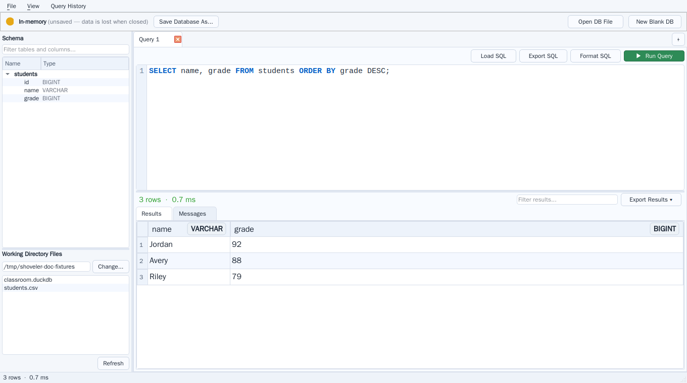
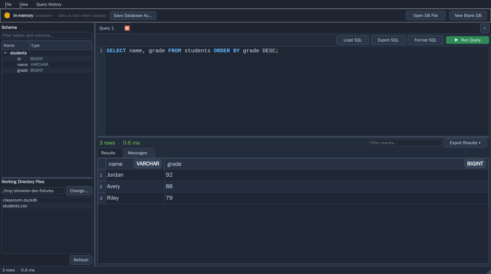
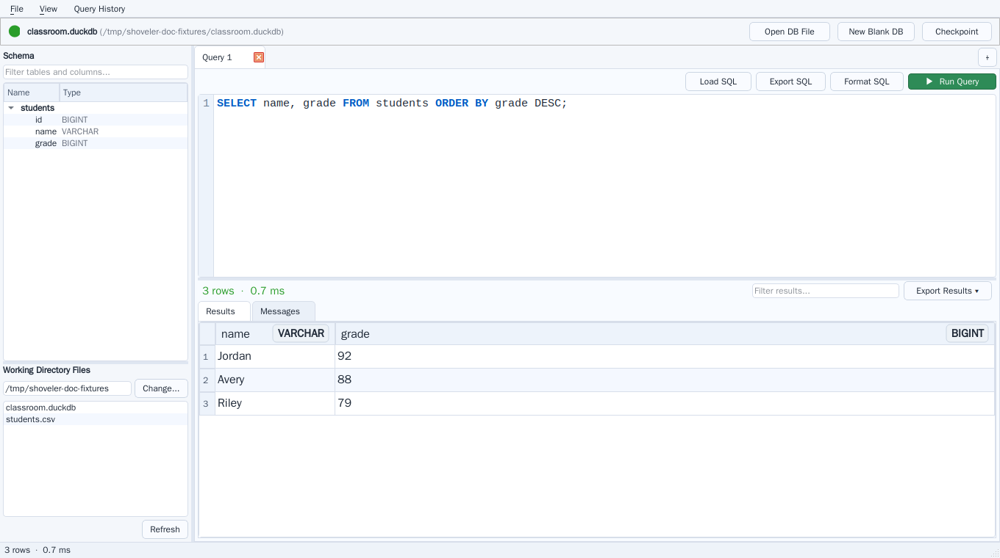
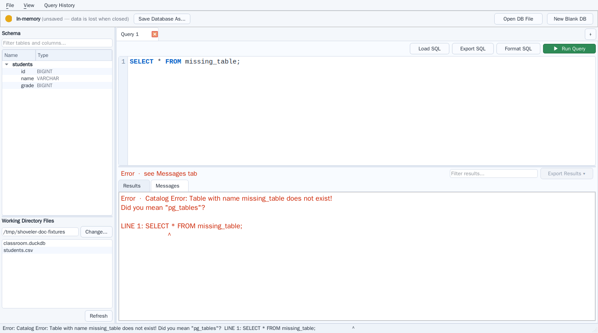

# Shoveler - A DuckDB Workbench

A minimal desktop SQL workbench for DuckDB, built with Python and PySide6.

Named after the [Australasian shoveler](https://en.wikipedia.org/wiki/Australasian_shoveler) - a species of "dabbling duck" - in honor of both the database's name and the app's purpose.

## Screenshots

| Light theme | Dark theme |
| --- | --- |
|  |  |

| File-backed database | Query error |
| --- | --- |
|  |  |

## Recommended for students and teachers: download a binary

Most classroom users should use the prebuilt desktop app from GitHub Releases instead of cloning or installing with pip.

1. Open the repo's [**Releases**](https://github.com/mrmatho/shoveler/releases) page.
2. Download the latest desktop package for your platform.
3. Extract it and run the app.

This is the fastest path for labs and avoids Python/tooling setup on student machines.

## Mac users - install from pip

The PyInstaller-built executable is not currently signed, which leads to the downloaded app being unusable without a workaround on macOS. For Mac users, the recommended option is to install from pip until code signing and notarization are set up.

### Installation with pip

```shell
pip install shoveler
```

### Running the app

```shell
python -m shoveler
```

Building from source is another option, but is more complex and intended for
developers. See the [developer guide](DEVELOPMENT.md).

## Usage

- **Open File** — connect to an existing `.duckdb` or `.db` file (green indicator)
- **New In-Memory** — scratch database; data is lost when closed (amber indicator)
- **File > Save Database As...** — save current database state to a `.duckdb` file
- **Checkpoint** — flush the write-ahead log to disk (file databases only)
- **F5 or Ctrl+Enter** — run query
- Select part of your SQL to run only that selection
- **File > Query History** — load a recent query into the current editor
- Modified query tabs are marked with `*`; closing or replacing one offers Save, Discard, or Cancel
- Filter schema tables and columns with the search field above the schema tree
- Double-click a table name in the schema panel to insert it into the editor
- **View > Syntax highlighting** — toggle SQL highlighting on or off; enabled by default and remembered between launches
- **View > Zoom** — increase, decrease, or reset font size for the editor and results panel
  - Editor: `Ctrl+=`, `Ctrl+-`, `Ctrl+0`
  - Results: `Ctrl+Shift+=`, `Ctrl+Shift+-`, `Ctrl+Shift+0`

## User documentation

The [Shoveler user documentation](docs/index.md) is the starting point for the
documentation website, published from the `docs/` folder. It is written for
students, teachers, and self-learners:

- [Quickstart](docs/quickstart.md) walks through installing Shoveler, opening
  or creating a database, running SQL, and saving or exporting your work.
- [Core Concepts](docs/concepts.md) explains database modes, query behavior,
  schema and results panels, shortcuts, and themes.
- [Troubleshooting](docs/troubleshooting.md) covers common setup, query, and
  database issues.
